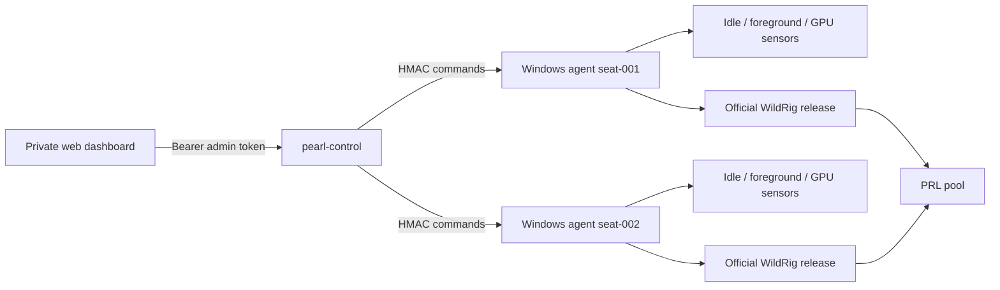

# Pearl Netbar Miner

Clean-room Windows net-cafe controller for Pearl (PRL) GPU mining.

It does not contain Vminer code, credentials, certificates, assets, or patched
third-party binaries. The controller itself has no mining fee. The pinned
WildRig 0.51.4 release states that `pearlhash` is a zero-fee algorithm; always
re-check upstream terms before changing miner versions.

> Only deploy on computers you own or are explicitly authorized to manage.
> Mining must be visible to the operator and must yield immediately to users.

## Current deliverable

This repository is the first runnable core, not a false claim of finished
Vminer parity.

| Capability | Status |
|---|---|
| Windows agent, pinned miner download and SHA-256 verification | Done |
| PearlHash launch/stop/restart lifecycle | Done |
| Smart yield based on user idle, foreground/full-screen app and other GPU processes | Done |
| Full / Avoid / Smart / Manual policy modes | Done |
| HMAC-authenticated heartbeats, commands and acknowledgements | Done |
| Private fleet service and minimal web dashboard | Done |
| Windows scheduled-task install/uninstall scripts | Done |
| Unit, API integration and Windows cross-build checks | Done |
| Live Windows GPU/pool acceptance test | Requires your test machine and PRL wallet |
| Hashrate/share parsing from WildRig-compatible JSON API | Implemented; needs live Windows verification |
| Per-GPU OC profiles and rollback | Next milestone |
| Signed auto-update and staged rollout | Next milestone |
| Full mobile-quality UI and multi-admin RBAC | Next milestone |

## Architecture



The fleet protocol has no arbitrary-shell command. Supported commands are
allowlisted: `start`, `stop`, `resume`, and `set-mode`.

## Build and test

Go 1.27 or newer:

```bash
go test ./...
go build -o bin/pearl-control ./cmd/pearl-control
GOOS=windows GOARCH=amd64 go build -o bin/pearl-agent.exe ./cmd/pearl-agent
```

## Start the private fleet service

Generate an administrator token and keep it outside Git:

```bash
export PEARL_ADMIN_TOKEN='replace-with-at-least-32-random-characters'
./bin/pearl-control serve \
  -listen 127.0.0.1:8080 \
  -data data/control-state.json
```

For a real café, expose it only through HTTPS (for example, behind Caddy) or
use the built-in `-tls-cert` and `-tls-key` flags. Do not send credentials over
plain LAN HTTP.

Enroll one seat:

```bash
./bin/pearl-control enroll \
  -url http://127.0.0.1:8080 \
  -id seat-001
```

The command prints a one-time agent secret. Put it in that seat's `config.json`.

## Configure a Windows seat

Copy `configs/agent.example.json` to `config.json`, then set:

- your own `prl1...` wallet;
- a unique worker name;
- the enrolled agent ID and secret;
- your HTTPS control URL;
- the pool endpoint you have verified.

The default miner artifact is the official WildRig Multi 0.51.4 Windows ZIP.
Both the GitHub-published archive SHA-256 and the extracted `wildrig.exe`
SHA-256 are pinned and checked before every launch.

Dry-run one policy cycle without downloading or starting a miner:

```powershell
.\pearl-agent.exe -config .\config.json -dry-run -once
```

Install it only after the dry-run output is correct:

```powershell
powershell -ExecutionPolicy Bypass -File .\scripts\install-agent.ps1 `
  -AgentExe C:\PearlNetbar\pearl-agent.exe `
  -ConfigPath C:\PearlNetbar\config.json
```

## Policy modes

- `full`: keep mining unless an operator sends `stop`.
- `avoid`: mine except when a blocked/full-screen app or another GPU process is active.
- `smart`: also require the configured user-idle period before starting; stop quickly on user activity.
- `manual`: never make an automatic start/stop decision.

Use `smart` for customer seats. `full` is intended only for dedicated rigs.

The current per-process GPU conflict sensor uses NVIDIA `nvidia-smi`. On AMD or
Intel seats, set `pause_on_other_gpu_process` to `false` only after validating
the idle/full-screen rules on that hardware; native AMD/Intel process sensing is
not yet implemented.

## Security decisions

- Official miner artifact is downloaded from GitHub and SHA-256 checked before extraction.
- ZIP path traversal is rejected.
- Agent requests are HMAC-SHA256 signed with timestamp and nonce replay protection.
- Fleet commands are an allowlist, not remote shell.
- Plain HTTP control URLs are rejected except loopback development URLs.
- Wallet and agent secret are never included in heartbeat payloads.
- The default web service binds to loopback.

See [docs/ARCHITECTURE.md](docs/ARCHITECTURE.md) and
[SECURITY.md](SECURITY.md) before production deployment.

## Upstream projects

- Pearl network: <https://github.com/pearl-research-labs/pearl>
- WildRig Multi: <https://github.com/andru-kun/wildrig-multi>

This project is not affiliated with Pearl Research Labs, WildRig, or Vminer.

