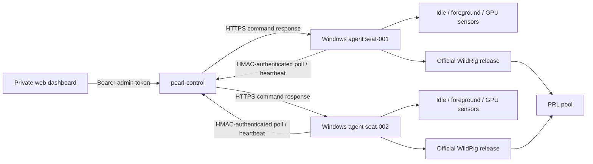

# Pearl Netbar Miner

Clean-room Windows net-cafe controller for Pearl (PRL) GPU mining.

It does not contain Vminer code, credentials, certificates, assets, or patched
third-party binaries. The controller itself has no mining fee. The pinned
WildRig 0.51.4 release states that `pearlhash` is a zero-fee algorithm; always
re-check upstream terms before changing miner versions.

> Only deploy on computers you own or are explicitly authorized to manage.
> Mining must be visible to the operator and must yield immediately to users.

## Current deliverable

This repository is an independently implemented PRL net-café controller. It is
not a Vminer clone and does not reuse Vminer code or credentials.

| Capability | Status |
|---|---|
| Windows agent, pinned miner download and SHA-256 verification | Done |
| PearlHash launch/stop/restart lifecycle | Done |
| Smart yield based on user idle, foreground/full-screen app and other GPU processes | Done |
| Whole-process game list, GPU start threshold, daily schedule and periodic rest | Done |
| Full / Avoid / Smart / Manual policy modes | Done |
| HMAC-authenticated agent polls, heartbeats and acknowledgements | Done |
| Batch fleet operations, command results, history, audit and viewer/operator/admin roles | Done |
| Per-GPU NVIDIA temperature/power/utilization reporting | Done |
| Per-GPU WildRig power/core/memory/fan profiles | Implemented; needs hardware stability validation |
| Zero-hash/no-share watchdog, bounded restarts and optional authorized reboot | Done; reboot is disabled by default |
| Owner-signed miner manifests, deterministic canaries and health rollback | Done; no signing key is bundled |
| Windows scheduled-task install/uninstall scripts | Done |
| Non-mutating Windows security and seat acceptance diagnostics | Done |
| Unit, API integration and Windows cross-build checks | Done |
| Live Windows GPU/pool acceptance test | Requires your test machine and PRL wallet |
| Hashrate/share parsing from WildRig-compatible JSON API | Implemented; needs live Windows verification |
| Native AMD/Intel process sensing | Not implemented |
| Agent self-update, native tray UI and diskless-image enrollment | Not implemented |
| Multiple coins/mining engines, pool balance, coin price and revenue | Out of current PRL-only scope |

## Architecture



The fleet protocol has no arbitrary-shell command. Supported commands are
allowlisted: lifecycle/mode, policy, mining settings, per-GPU profiles and
explicitly gated reboot/shutdown. Every acknowledgement records success or an
error message.

## Build and test

Go 1.27 or newer:

```bash
go test ./...
go build -o bin/pearl-control ./cmd/pearl-control
go build -o bin/pearl-manifest ./cmd/pearl-manifest
GOOS=windows GOARCH=amd64 go build -o bin/pearl-agent.exe ./cmd/pearl-agent
```

## Start the private fleet service

Generate an administrator token and keep it outside Git:

```bash
export PEARL_ADMIN_TOKEN='replace-with-at-least-32-random-characters'
export PEARL_OPERATOR_TOKEN='optional-separate-operator-token'
export PEARL_VIEWER_TOKEN='optional-separate-read-only-token'
./bin/pearl-control serve \
  -listen 127.0.0.1:8080 \
  -data data/control-state.json
```

For a real café, expose it only through HTTPS (for example, behind Caddy) or
use the built-in `-tls-cert` and `-tls-key` flags. Do not send credentials over
plain LAN HTTP.

Enroll one seat:

```bash
./bin/pearl-control enroll \
  -url http://127.0.0.1:8080 \
  -id seat-001
```

The command prints a one-time agent secret. Put it in that seat's `config.json`.

## Configure a Windows seat

Copy `configs/agent.example.json` to `config.json`, then set:

- your own `prl1...` wallet;
- a unique worker name;
- the enrolled agent ID and secret;
- your HTTPS control URL;
- the pool endpoint you have verified.

The default miner artifact is the official WildRig Multi 0.51.4 Windows ZIP.
Both the GitHub-published archive SHA-256 and the extracted `wildrig.exe`
SHA-256 are pinned and checked before every launch.

Dry-run one policy cycle without downloading or starting a miner:

```powershell
.\pearl-agent.exe -config .\config.json -dry-run -once
```

Install it only after the dry-run output is correct:

```powershell
powershell -ExecutionPolicy Bypass -File .\scripts\install-agent.ps1 `
  -AgentExe C:\PearlNetbar\pearl-agent.exe `
  -ConfigPath C:\PearlNetbar\config.json
```

Run the non-mining acceptance check before a pilot:

```powershell
powershell -ExecutionPolicy Bypass -File .\scripts\verify-seat.ps1 `
  -AgentExe C:\PearlNetbar\pearl-agent.exe `
  -ConfigPath C:\PearlNetbar\config.json
```

## Policy modes

- `full`: keep mining unless an operator sends `stop`.
- `avoid`: mine except when a blocked/full-screen app or another GPU process is active.
- `smart`: also require the configured user-idle period before starting; stop quickly on user activity.
- `manual`: never make an automatic start/stop decision.

Use `smart` for customer seats. `full` is intended only for dedicated rigs.

The current per-process GPU conflict sensor uses NVIDIA `nvidia-smi`. On AMD or
Intel seats, set `pause_on_other_gpu_process` to `false` only after validating
the idle/full-screen rules on that hardware. Also disable
`pause_on_gpu_utilization` because vendor-neutral utilization telemetry is not
yet implemented. The whole-process game list still works on Windows regardless
of GPU vendor.

The GPU utilization threshold is intentionally a start gate only. Total GPU
utilization includes the miner itself, so using it as a stop rule would make the
miner stop itself. Once mining is running, the agent yields to the whole-process
game list, foreground/full-screen checks, input activity and other GPU compute
processes.

## Signed miner updates

Automatic upstream updates are disabled by default. The fleet accepts only a
manifest signed by your own Ed25519 key, so a new miner version cannot enter the
fleet merely because an upstream release changed.

```bash
pearl-manifest keygen -private manifest-private.key -public manifest-public.key
pearl-manifest sign \
  -private manifest-private.key \
  -input configs/update-manifest.example.json \
  -output stable.signed.json
pearl-manifest verify -public manifest-public.key -input stable.signed.json
```

Keep the private key offline and outside the repository. Put the public key and
HTTPS manifest URL in the agent config. `canary_percent` gives each seat a
deterministic rollout bucket. The candidate archive and executable hashes are
verified before activation; repeated health failures roll back to the previous
pinned miner.

This updates the mining engine, not `pearl-agent.exe` itself. Agent self-update
is intentionally deferred until Windows code signing and a separate updater
have been validated.

## Security decisions

- Official miner artifact is downloaded from GitHub and SHA-256 checked before extraction.
- ZIP path traversal is rejected.
- Agent requests are HMAC-SHA256 signed with timestamp and nonce replay protection.
- Fleet commands are an allowlist, not remote shell.
- Viewer, operator and administrator tokens are separate when configured.
- Remote reboot/shutdown is rejected unless enabled locally on that seat.
- Signed update manifests prevent unsigned miner changes and stale replay.
- Plain HTTP control URLs are rejected except loopback development URLs.
- Wallet and agent secret are never included in heartbeat payloads.
- The default web service binds to loopback.

See [docs/ARCHITECTURE.md](docs/ARCHITECTURE.md),
[docs/OPERATIONS.md](docs/OPERATIONS.md), [docs/TEST_PLAN.md](docs/TEST_PLAN.md)
and [SECURITY.md](SECURITY.md) before production deployment.

## Upstream projects

- Pearl network: <https://github.com/pearl-research-labs/pearl>
- WildRig Multi: <https://github.com/andru-kun/wildrig-multi>

This project is not affiliated with Pearl Research Labs, WildRig, or Vminer.

